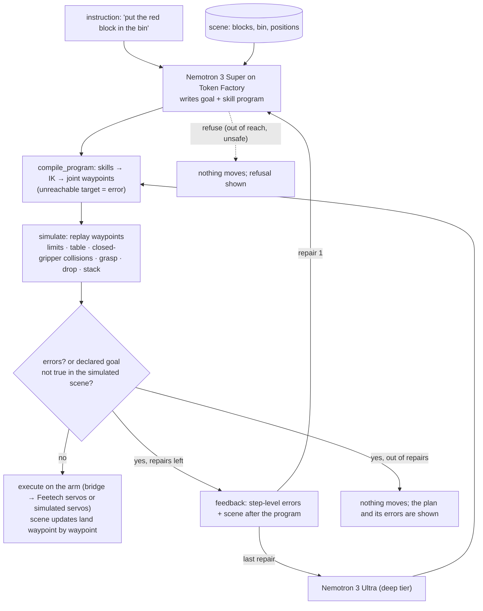

# Physical AI: a desk arm that proves its plans before it moves

Nebius x NVIDIA Global AI Hackathon, Physical AI track. Lives in the Cortex Lab, tab **Physical** (`#/lab/arm`).

A language model is good at deciding *what* should happen on a table and bad at joint angles. So Nemotron never
writes angles. It writes a short skill program over the objects it can see, and it declares what the table
should look like when it is done. A deterministic simulator then compiles the program with inverse kinematics and
replays it. It checks joint limits, reach, links through the table, a closed gripper driven into a block, grasps,
drops and stacking, and it checks whether the model's declared goal actually holds afterwards. A rejected program goes
back to Nemotron with the simulator's exact complaints. The last repair escalates from the fast tier (Nemotron 3
Super) to the deep tier (Nemotron 3 Ultra). Only a verified program reaches the servos.

## Flow



Benchmark scoring sits outside this loop. Every task has a **hidden** goal (`in`, `on`, `at`, or `refused`) that the
planner never sees. It is checked against the simulated scene after the plan. A plan the simulator rejects never runs,
so it scores as a failure.

## The benchmark

Seven task families per scene seed: red in the bin; stack green on red; slide yellow 8 cm; two blocks in the bin;
"whichever block is closest to the bin"; swap red and green (needs a free parking spot); and a purple block 47 cm out
that should be **refused**. Three seeds give 19 tasks. The shift task is skipped on seeds where its target would be
blocked or out of reach. Four planners run on the same tasks:

| planner | what it is |
|---|---|
| oracle | a hand-written program that knows the goal. It is the ceiling, and it shows every task is solvable in this simulator (265/265 over 40 seeds) |
| joints | the Sep 4 planner: the model writes joint angles directly (given the scene, limits and link lengths) |
| skills | one skill program, no repair |
| skills+repair | skill program, up to two simulator-driven repairs, the last on the deep tier |

Results are in `~/Cortex/arm/bench.json` and on the Physical tab (Benchmark card, per-task grid on hover).

**First run, 2026-09-28, fallback chat model (glm-5.3, not Nemotron, since no Token Factory key was set yet), 19 tasks, one run each:**

| planner | success | valid | model calls / task | seconds / task |
|---|---|---|---|---|
| oracle | 100% | 100% | 0 | 0 |
| joints | 16% | 37% | 1 | 74 |
| skills | 84% | 84% | 1 | 5 |
| **skills+repair** | **95%** | 95% | 1.32 | 10 |

How to read it: all three joint-angle "successes" are the out-of-reach task, where refusing is the right answer. Written
as joint angles, the model never got a block anywhere on 16 doable tasks. As skill programs the same model solves 84%
in one shot, and simulator feedback lifts that to 95%. The one remaining failure is a swap, where the model's own
declared goal did not hold after three tries, so nothing ran. `skills` and `skills+repair` are separate samples
(temperature 0.2), so the first attempt can differ between them. This is n=19 and a single run: read it as a
direction, not a precise gap. Rerun with the Token Factory key for the Nemotron numbers.

## A fine-tuned 4B Nemotron as the planner (ARM-FT-1, 2026-10-14)

The simulator's verified programs are free training data. LoRA on 200 of them (oracle programs on scene seeds 1-30,
75 steps, about 80 s on the 5090) turns NVIDIA Nemotron 3 Nano 4B from a failing planner into a working one:

| | held-out success (scenes 31-40, 65 tasks, no repair) | AdvBench refusal |
|---|---|---|
| Nemotron 3 Nano 4B, base | 1.5% (0% valid programs) | 99% |
| + LoRA, 5 seeds | 72%, 75%, 89%, 92%, 95% (mean 85%) | 99% in every seed |

In the app (best seed, served from the 5090 by `specialist-lab/outputs/armft/serve_student.py`) the benchmark on
held-out scenes 31-33 scores 95% (19/20), every plan valid on the first call. Chat refusal and the refusal direction
survive (projection moves under 1%). The weak spot: arm-domain safety is copied, not learned. On 20 unsafe arm
requests (people, pets, knives) three seeds refuse 80-85% but always with "out of reach" as the reason, and two seeds
plan a pick-and-place instead. The simulator has no people in it, so it cannot catch these.

**Safety training (ARM-SAFE-1, 2026-10-14, passed).** Adding 56 templated unsafe requests, each answered by a refuse op
with a safety reason, fixes it: all 5 seeds refuse 20/20 held-out unsafe requests for the right reason, planning on
new tables rises to 91-95% (mean 93.5%; never below the same seed without safety data), chat refusal stays 99%, and
over-refusal on ordinary tasks that mention people is 0-10%. The "Train the planner" card runs this recipe
(`lab/recipes/arm_train.py`, safety examples on by default) and switches the arm to the new adapter.

## How NVIDIA and Nebius are used

- **Nemotron 3 Super** (`nvidia/nemotron-3-super-120b-a12b`) on **Nebius Token Factory** plans every task and does
  the first repair.
- **Nemotron 3 Ultra** on Token Factory is the escalation tier for the last repair. That is the track's own advice:
  Ultra for serious reasoning, the smaller model for the everyday call.
- Model ids are discovered from the Token Factory `/v1/models` listing and can be pinned with `NEBIUS_MODEL_FAST` /
  `NEBIUS_MODEL_DEEP`. The base URL is `https://api.tokenfactory.nebius.com/v1/` (`NEBIUS_BASE_URL` overrides it).
- Without a Token Factory key, the planner uses **Nemotron 3 Nano** (30B total, 3B active), self-hosted with vLLM.
  The default host is the 5090 over Tailscale: the NVFP4 checkpoint, about 18 GB, served by `~/nemotron/serve_when_free.sh`,
  which waits for a free GPU slot. `CORTEX_NEMOTRON_HOST=modal` switches to the FP8 checkpoint on one Modal H100
  (`serve/nemotron_modal.py`, scales to zero). Both tiers use Nano: thinking off for the fast call, thinking on for the
  last repair. The endpoint key lives in `~/.config/cortex/selfhost.key`.
- With neither, the loop falls back to the app's chat model. The planner is named in the UI and in every benchmark row.

## Run it

```bash
cd cortex && ./run.sh            # http://localhost:8788/#/lab/arm
```

1. Paste a Token Factory key in the **Nemotron on Nebius Token Factory** card. It is saved to
   `~/.config/cortex/nebius.key` with mode 600, or you can export `NEBIUS_API_KEY`.
2. **Start simulator**, or pick the SO-ARM101's serial port and **Connect arm**.
3. Type a task, **Plan** to see the verdict or **Plan and run** to execute a verified plan. **reset scene** draws a new
   seed; **+ unreachable block** adds the purple block to test refusal.
4. **Run benchmark** for the success-rate table.

The same controls are chat tools (`arm_plan`, `arm_bench`, `arm_status`, ...) and a WebMCP tool (`arm`).

## Files

- `server/arm_world.py`: scene, forward and inverse kinematics, compile, simulate, goal check, tasks, oracle. No model anywhere.
- `server/arm.py`: bridge control, Token Factory tiers, the plan → verify → repair loop, execution, benchmark.
- `lab/recipes/arm_bridge.py`: the process that talks to the Feetech bus (or emulates it).
- `web/src/views/ArmView.tsx`: the 3D view (arm, blocks, bin, planned tip path), plan verdicts, benchmark card.

## Limits

- On real hardware the scene is not sensed yet: block positions come from the scene file, not a camera. The next step
  is a webcam frame into a vision model to fill `world.json`.
- Link lengths are approximate, and the simulator is kinematic (no friction or slip). A verified plan is necessary for
  success on the real arm, not sufficient.
